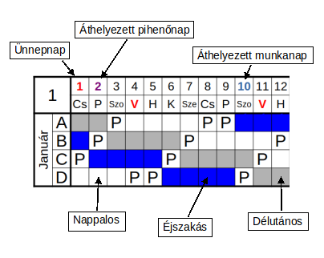
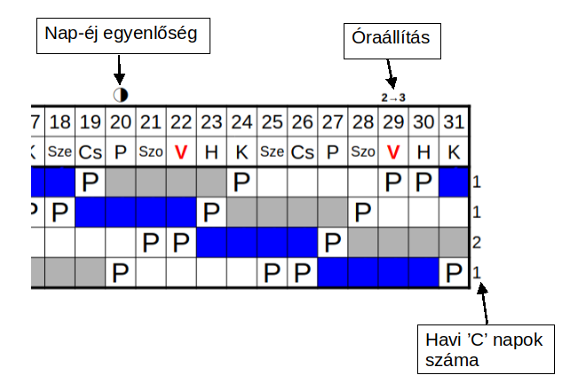
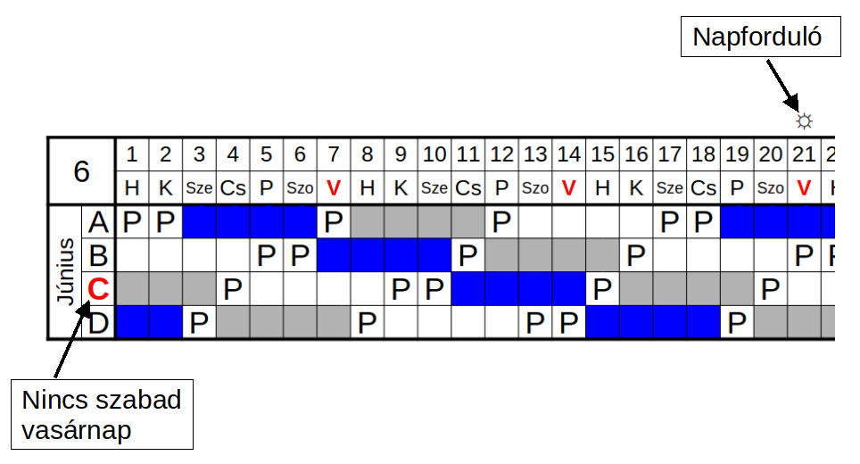

# Műszaknaptár
Automata műszaknaptár Dunai Vasmű 8 órás folytonos munkarendhez.

- Használata:

    Az első munkafüzetben az évet kell átírni, valamit a "Munkaszüneti napok" munkafüzetben a munkanap-áthelyezéseket kitölteni. A jelenlegi mozgó ünnepek 2015-2055 autumatikusan kitöltődnek.
- A munkanapok számításánál nem veszi figyelembe a munkanap-áthelyezéseket. Amíg hónapon belül vannak az áthelyezések nincs jelentősége.

## Makró nélküli megoldás:
###### [(Muszaknaptar_mn.ods)](./Muszaknaptar_mn.ods)
- Ez alap függvényekkel valósítja meg ugyan azt: a 16-al való osztás maradékát megfelelteti, a műszak jelével:
```calc
=KÖZÉP("ÉÉÉÉPDDDDPNNNNPP";MARADÉK(INDIREKT("r[-2]";0);16)+1;1)
```
- A többi műszak ehhez képest **4**, 8 vagy 12 nappal el van tolva
```calc
=KÖZÉP("ÉÉÉÉPDDDDPNNNNPP";MARADÉK(INDIREKT("r[-3]";0)-4;16)+1;1)
```

## Jelmagyarázat:



